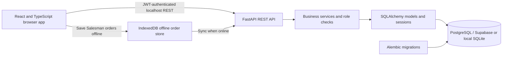
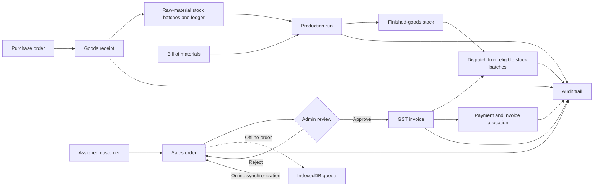

# Food Manufacturing Management System

## Project Overview

A localhost web application for food manufacturing operations. The current backend provides role-based authentication, customer and supplier masters, sales order handling, GST invoicing, production-run tracking, dashboards, and offline sales-order synchronization.

## Start here

The configured evaluator database is preloaded with the mandatory Murukku scenario. If the local environment is already set up, start both services from the project root:

```powershell
.\run-local.ps1
```

Open `http://127.0.0.1:5173/login` and select a role in **Quick Demo Login**. All six demonstration accounts use `Demo123!`; see [Demo Login](#demo-login).

## Key Features

- JWT login, hashed passwords, user administration, and backend-enforced role checks.
- Customer and supplier list, detail, create, and update endpoints.
- Sales order create, list, detail, update, submit, approve, reject, cancel, and stock availability endpoints.
- GST invoice create, list, detail, post, and cancel endpoints.
- Production run list, detail, create, start, and cancel endpoints.
- Role-specific dashboards for Factory Admin, Salesman, Production Supervisor, Accountant/Auditor, and Owner.
- Salesman offline order storage in browser IndexedDB and idempotent synchronization with the backend.
- Vite PWA configuration for installable app support and prompted updates.
- SQLAlchemy models and services for inventory, purchasing, dispatch, payments, and reporting are present.

**API coverage:** the inventory, product, purchasing, dispatch, payment, and report route modules are currently empty and are not included in the API router. Their frontend pages and backend data models/services exist, but those workflows are not currently available through the mounted API. Do not treat those screens as verified functional features.

## User Roles

| Role | Current API responsibilities |
|---|---|
| Factory Admin | Manage users, customers, and suppliers; review sales orders; manage invoices; access the admin dashboard. |
| Salesman | Work with assigned customers and sales orders; keep orders offline and synchronize them when connected. |
| Production Supervisor | View, create, start, and cancel production runs; access the production dashboard. |
| Accountant/Auditor | View the read-only financial dashboard. |
| Owner | View the read-only business dashboard. |

There are two demo Salesman accounts, Salesman A and Salesman B, for the single Salesman role.

## Technology Stack

| Layer | Technologies |
|---|---|
| Frontend | React 19, TypeScript, Vite, React Router, Tailwind CSS, Recharts, IndexedDB (`idb`), Vite PWA plugin |
| Backend | Python 3.12, FastAPI, Pydantic 2, SQLAlchemy 2, Uvicorn |
| Data and migrations | PostgreSQL (including Supabase) or local SQLite; Alembic |
| Authentication | JWT (`PyJWT`), Argon2 password hashing (`pwdlib`) |
| Tests | pytest, httpx; frontend TypeScript typecheck, ESLint, Vite build |

## System Architecture



## Database Design

The diagrams below show SQLAlchemy entities and their declared primary and foreign keys. Product, raw-material, and packaging detail rows use the corresponding `inventory_items` ID as their primary key and foreign key. `source_type`/`source_id` and `audit_logs.entity_id` are generic references, not database foreign keys.

### Users, master data, inventory, and purchasing

```mermaid
erDiagram
    USERS {
        uuid user_id PK
    }
    ROLES {
        uuid role_id PK
    }
    USER_ROLES {
        uuid user_role_id PK
        uuid user_id FK
        uuid role_id FK
    }
    CUSTOMERS {
        uuid customer_id PK
        uuid assigned_salesman_id FK
    }
    SUPPLIERS {
        uuid supplier_id PK
    }
    INVENTORY_ITEMS {
        uuid item_id PK
    }
    PRODUCTS {
        uuid product_id PK
    }
    RAW_MATERIALS {
        uuid material_id PK
    }
    PACKAGING_MATERIALS {
        uuid packaging_id PK
    }
    UNIT_CONVERSIONS {
        uuid conversion_id PK
    }
    PRODUCT_BOMS {
        uuid bom_id PK
        uuid product_id FK
    }
    BOM_ITEMS {
        uuid bom_item_id PK
        uuid bom_id FK
        uuid item_id FK
    }
    INVENTORY_BALANCES {
        uuid balance_id PK
        uuid item_id FK
    }
    STOCK_BATCHES {
        uuid batch_id PK
        uuid item_id FK
    }
    STOCK_MOVEMENTS {
        uuid movement_id PK
        uuid item_id FK
        uuid batch_id FK
        uuid reversal_of_id FK
        uuid created_by FK
    }
    STOCK_ADJUSTMENTS {
        uuid adjustment_id PK
        uuid created_by FK
        uuid approved_by FK
    }
    STOCK_ADJUSTMENT_ITEMS {
        uuid adjustment_item_id PK
        uuid adjustment_id FK
        uuid item_id FK
        uuid batch_id FK
    }
    PURCHASE_ORDERS {
        uuid purchase_order_id PK
        uuid supplier_id FK
        uuid created_by FK
    }
    PURCHASE_ORDER_ITEMS {
        uuid po_item_id PK
        uuid purchase_order_id FK
        uuid item_id FK
    }
    GOODS_RECEIPTS {
        uuid receipt_id PK
        uuid purchase_order_id FK
        uuid received_by FK
    }
    GOODS_RECEIPT_ITEMS {
        uuid receipt_item_id PK
        uuid receipt_id FK
        uuid po_item_id FK
    }

    USERS ||--o| USER_ROLES : has
    ROLES ||--o{ USER_ROLES : assigned_as
    USERS ||--o{ CUSTOMERS : assigned_salesman
    INVENTORY_ITEMS ||--o| PRODUCTS : product_details
    INVENTORY_ITEMS ||--o| RAW_MATERIALS : raw_material_details
    INVENTORY_ITEMS ||--o| PACKAGING_MATERIALS : packaging_details
    PRODUCTS ||--o{ PRODUCT_BOMS : has_versions
    PRODUCT_BOMS ||--o{ BOM_ITEMS : contains
    INVENTORY_ITEMS ||--o{ BOM_ITEMS : required_item
    INVENTORY_ITEMS ||--o{ INVENTORY_BALANCES : has_balances
    INVENTORY_ITEMS ||--o{ STOCK_BATCHES : has_batches
    INVENTORY_ITEMS ||--o{ STOCK_MOVEMENTS : moved_item
    STOCK_BATCHES o|--o{ STOCK_MOVEMENTS : movement_batch
    STOCK_MOVEMENTS o|--o{ STOCK_MOVEMENTS : reverses
    USERS ||--o{ STOCK_MOVEMENTS : created_by
    USERS ||--o{ STOCK_ADJUSTMENTS : created_by
    USERS o|--o{ STOCK_ADJUSTMENTS : approved_by
    STOCK_ADJUSTMENTS ||--o{ STOCK_ADJUSTMENT_ITEMS : contains
    INVENTORY_ITEMS ||--o{ STOCK_ADJUSTMENT_ITEMS : adjusted_item
    STOCK_BATCHES o|--o{ STOCK_ADJUSTMENT_ITEMS : adjusted_batch
    SUPPLIERS ||--o{ PURCHASE_ORDERS : receives_orders
    USERS ||--o{ PURCHASE_ORDERS : created_by
    PURCHASE_ORDERS ||--o{ PURCHASE_ORDER_ITEMS : contains
    INVENTORY_ITEMS ||--o{ PURCHASE_ORDER_ITEMS : ordered_item
    PURCHASE_ORDERS ||--o{ GOODS_RECEIPTS : received_against
    USERS ||--o{ GOODS_RECEIPTS : received_by
    GOODS_RECEIPTS ||--o{ GOODS_RECEIPT_ITEMS : contains
    PURCHASE_ORDER_ITEMS ||--o{ GOODS_RECEIPT_ITEMS : received_line
```



### Production, sales, invoicing, payments, and audit

```mermaid
erDiagram
    USERS {
        uuid user_id PK
    }
    CUSTOMERS {
        uuid customer_id PK
    }
    PRODUCTS {
        uuid product_id PK
    }
    PRODUCT_BOMS {
        uuid bom_id PK
    }
    INVENTORY_ITEMS {
        uuid item_id PK
    }
    STOCK_BATCHES {
        uuid batch_id PK
    }
    PRODUCTION_RUNS {
        uuid production_run_id PK
        uuid product_id FK
        uuid bom_id FK
        uuid supervisor_id FK
    }
    PRODUCTION_MATERIALS {
        uuid production_material_id PK
        uuid production_run_id FK
        uuid item_id FK
        uuid batch_id FK
    }
    PRODUCTION_OUTPUTS {
        uuid output_id PK
        uuid production_run_id FK
        uuid product_id FK
        uuid batch_id FK
    }
    PRODUCTION_EXPENSES {
        uuid expense_id PK
        uuid production_run_id FK
        uuid recorded_by FK
    }
    PRODUCTION_COST_SUMMARIES {
        uuid cost_summary_id PK
        uuid production_run_id FK
    }
    SALES_ORDERS {
        uuid sales_order_id PK
        uuid customer_id FK
        uuid salesman_id FK
    }
    SALES_ORDER_ITEMS {
        uuid sales_order_item_id PK
        uuid sales_order_id FK
        uuid product_id FK
    }
    ORDER_APPROVAL_HISTORY {
        uuid approval_history_id PK
        uuid sales_order_id FK
        uuid decided_by FK
    }
    INVOICES {
        uuid invoice_id PK
        uuid order_id FK
        uuid customer_id FK
        uuid original_invoice_id FK
    }
    INVOICE_ITEMS {
        uuid invoice_item_id PK
        uuid invoice_id FK
        uuid order_item_id FK
        uuid product_id FK
    }
    DISPATCHES {
        uuid dispatch_id PK
        uuid invoice_id FK
    }
    DISPATCH_ITEMS {
        uuid dispatch_item_id PK
        uuid dispatch_id FK
        uuid invoice_item_id FK
        uuid product_id FK
        uuid batch_id FK
    }
    PAYMENTS {
        uuid payment_id PK
        uuid customer_id FK
        uuid recorded_by FK
    }
    PAYMENT_ALLOCATIONS {
        uuid allocation_id PK
        uuid payment_id FK
        uuid invoice_id FK
    }
    AUDIT_LOGS {
        uuid audit_id PK
        uuid user_id FK
    }
    SYNC_RECORDS {
        uuid sync_id PK
        uuid user_id FK
        uuid order_id FK
    }

    PRODUCTS ||--o{ PRODUCTION_RUNS : produced_in
    PRODUCT_BOMS ||--o{ PRODUCTION_RUNS : planned_with
    USERS ||--o{ PRODUCTION_RUNS : supervises
    PRODUCTION_RUNS ||--o{ PRODUCTION_MATERIALS : consumes
    INVENTORY_ITEMS ||--o{ PRODUCTION_MATERIALS : material
    STOCK_BATCHES ||--o{ PRODUCTION_MATERIALS : issued_from
    PRODUCTION_RUNS ||--o{ PRODUCTION_OUTPUTS : yields
    PRODUCTS ||--o{ PRODUCTION_OUTPUTS : output_product
    STOCK_BATCHES ||--o{ PRODUCTION_OUTPUTS : output_batch
    PRODUCTION_RUNS ||--o{ PRODUCTION_EXPENSES : costs
    USERS ||--o{ PRODUCTION_EXPENSES : recorded_by
    PRODUCTION_RUNS ||--o| PRODUCTION_COST_SUMMARIES : costed_as
    CUSTOMERS ||--o{ SALES_ORDERS : places
    USERS ||--o{ SALES_ORDERS : salesman
    SALES_ORDERS ||--o{ SALES_ORDER_ITEMS : contains
    PRODUCTS ||--o{ SALES_ORDER_ITEMS : ordered_product
    SALES_ORDERS ||--o{ ORDER_APPROVAL_HISTORY : decisions
    USERS ||--o{ ORDER_APPROVAL_HISTORY : decided_by
    SALES_ORDERS ||--o{ INVOICES : invoiced_as
    CUSTOMERS ||--o{ INVOICES : billed
    INVOICES o|--o{ INVOICES : corrected_by
    INVOICES ||--o{ INVOICE_ITEMS : contains
    SALES_ORDER_ITEMS ||--o{ INVOICE_ITEMS : invoiced_line
    PRODUCTS ||--o{ INVOICE_ITEMS : invoiced_product
    INVOICES ||--o{ DISPATCHES : fulfilled_by
    DISPATCHES ||--o{ DISPATCH_ITEMS : contains
    INVOICE_ITEMS ||--o{ DISPATCH_ITEMS : dispatched_line
    PRODUCTS ||--o{ DISPATCH_ITEMS : dispatched_product
    STOCK_BATCHES ||--o{ DISPATCH_ITEMS : dispatched_batch
    CUSTOMERS ||--o{ PAYMENTS : pays
    USERS ||--o{ PAYMENTS : recorded_by
    PAYMENTS ||--o{ PAYMENT_ALLOCATIONS : allocated
    INVOICES ||--o{ PAYMENT_ALLOCATIONS : settled_by
    USERS ||--o{ AUDIT_LOGS : performed
    USERS ||--o{ SYNC_RECORDS : synchronized_by
    SALES_ORDERS o|--o{ SYNC_RECORDS : accepted_order
```



## Business Workflow



The purchase, inventory, dispatch, payment, and report modules shown in the data model are not all exposed by mounted routes yet; see [Key Features](#key-features).

## Project Structure

```text
.
├── backend/
│   ├── alembic/                  # Database migrations
│   ├── app/
│   │   ├── api/routes/           # Mounted REST routes and route modules
│   │   ├── core/                 # Settings, database, security, demo accounts
│   │   ├── models/               # SQLAlchemy entities and relationships
│   │   ├── schemas/              # Pydantic request and response schemas
│   │   ├── services/             # Business and transaction logic
│   ├── tests/
│   │   ├── unit/
│   │   ├── integration/
│   │   └── benchmark/
│   ├── .env.example
│   ├── alembic.ini
│   └── requirements.txt
├── database/
│   ├── fixtures/                 # Mandatory scenario data
│   └── seeds/                    # Demo-user and benchmark seed scripts
├── frontend/
│   ├── public/                   # PWA icons and static assets
│   ├── src/
│   │   ├── app/                  # App shell, providers, route guards
│   │   ├── components/
│   │   ├── features/             # Role dashboards and business screens
│   │   ├── services/             # API, offline storage, synchronization
│   │   ├── styles/
│   │   ├── types/
│   │   └── utils/
│   ├── .env.example
│   ├── package.json
│   └── vite.config.ts
└── run-local.ps1                 # Local migration and service launcher
```

## Getting Started

### Prerequisites

- Windows PowerShell.
- Python 3.12 and pip.
- Node.js and npm.
- A PostgreSQL database (the configured evaluator environment uses Supabase) or a local-development SQLite URL.

### First-time setup

1. Create the backend environment file and configure the database URL and a private random secret. Keep this file local; it is ignored by Git.

   ```powershell
   Copy-Item backend/.env.example backend/.env
   ```

   Set `ENVIRONMENT=development`, `DATABASE_URL` to the development database, and `SECRET_KEY` to a private random value of at least 32 characters. Set `DEMO_MODE=true` only for localhost demonstrations. The demo buttons are disabled by default and aren’t available in production. Without a `DATABASE_URL`, the backend configuration defaults to the local SQLite file `backend/food_manufacturing.db`.

2. Install backend dependencies:

   ```powershell
   python -m venv backend/.venv
   backend/.venv/Scripts/python.exe -m pip install -r backend/requirements.txt
   ```

3. Install frontend dependencies:

   ```powershell
   Push-Location frontend
   npm install
   Pop-Location
   ```

4. Start both services from the project root:

   ```powershell
   .\run-local.ps1
   ```

The launcher applies Alembic migrations, starts Uvicorn and Vite on loopback, and writes logs under `.tmp/runtime-logs`. It expects `backend/.venv` and `frontend/node_modules`. `-NoMigration` skips automatic migrations if required for a prepared local database. Stop the processes from Task Manager when finished; the launcher starts them hidden.

The configured evaluator database already has demo users and scenario data. To initialize a separate development database, first create the six demo users, then seed the mandatory scenario. Run these from the project root after configuring `backend/.env`:

```powershell
Push-Location backend
try {
    .\.venv\Scripts\python.exe ..\database\seeds\seed_demo_users.py --apply --evaluator-demo
    .\.venv\Scripts\python.exe ..\database\seeds\seed_benchmark.py --apply
}
finally { Pop-Location }
```

The user seed retains matching user IDs and roles; `--evaluator-demo` sets the demo password hash for matching accounts. The benchmark seed is transactional and idempotent. It refuses production and will verify a complete existing scenario without resetting it.

## Application Access

| Service | Local URL |
|---|---|
| Frontend | [http://127.0.0.1:5173](http://127.0.0.1:5173) |
| Login | [http://127.0.0.1:5173/login](http://127.0.0.1:5173/login) |
| Backend health | [http://127.0.0.1:8000/health](http://127.0.0.1:8000/health) |
| OpenAPI / Swagger UI | [http://127.0.0.1:8000/docs](http://127.0.0.1:8000/docs) |
| OpenAPI schema | [http://127.0.0.1:8000/openapi.json](http://127.0.0.1:8000/openapi.json) |

The versioned API prefix is `/api/v1`.

## Demo Login

These simplified credentials are for the configured local demonstration database only. Keep `DEMO_MODE=true` limited to localhost development; never use these accounts in production.

| Role | Username | Password |
|---|---|---|
| Factory Admin | `admin` | `Demo123!` |
| Salesman A | `salesa` | `Demo123!` |
| Salesman B | `salesb` | `Demo123!` |
| Production Supervisor | `production` | `Demo123!` |
| Accountant/Auditor | `accountant` | `Demo123!` |
| Owner | `owner` | `Demo123!` |

At `/login`, click a labelled role button under **Quick Demo Login** to authenticate through the normal backend login and open its role dashboard. The short usernames also work in the manual login form. Authentication uses stored password hashes and JWTs; authorization remains enforced by the backend.

## Mandatory Scenario

The configured local demo database contains the completed mandatory Murukku 200 g scenario: a 60 kg flour receipt, production of 188 good packets, a Tamil Nadu retailer invoice and dispatch, a Karnataka distributor order showing the 32-packet shortage, and a ₹4,000 allocated payment. The expected invoice is ₹7,875 and the remaining receivable is ₹3,875. The seed records inventory movements and runs validation in the same database transaction. Re-running it against a complete scenario verifies the records without changing them; it does not reset the database.

The problem statement specifies 50 opening finished packets but no valuation. The local fixture records the approved demo assumption of ₹19.85 per packet, derived from the opening BOM material and packaging costs. This is an assumption for the demonstration, not a source-provided value.

For an isolated, repeatable mandatory-scenario check, run from `backend`:

```powershell
.\.venv\Scripts\python.exe -m pytest tests/benchmark/test_mandatory_scenario.py -q
```

The test creates a fresh in-memory SQLite database and checks scenario results and seed idempotency. The live demo database is already in the completed state; use the isolated test for the clean initial state.

## Testing

Run backend tests from `backend`:

```powershell
.\.venv\Scripts\python.exe -m pytest
```

Run the focused benchmark test using the command above. Frontend checks from `frontend`:

```powershell
npm run typecheck
npm run lint
npm run build
```

Verified results available for this project state: the isolated mandatory scenario test passed (`1 passed`), the frontend TypeScript typecheck passed, the local health endpoint returned HTTP 200, all six demo accounts authenticated, all five role dashboard endpoints returned successfully, and a Salesman request to the admin dashboard was denied with HTTP 403. The full backend suite, lint, and production frontend build have not been verified for this README update.
